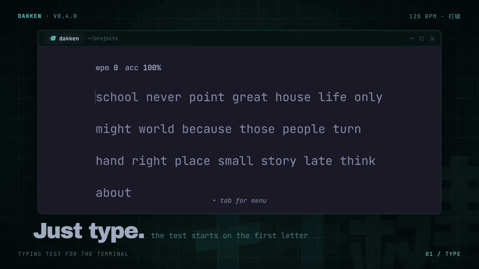

<p align="center">
  
</p>

# dakken

A typing-speed test for the terminal.

<p align="center">
  
</p>

- Words mode (10, 25, 50, 100 words); 100 words is the default.
- Time mode (15, 30, 60, 120 s).
- Untimed mode: type the words that fill the screen, with no time limit.
- The text fills 70% of the terminal, with an empty row between lines.
- Quote mode: one quote from a public-domain book, poem or speech. Choose
  short (up to 15 words), medium (16 to 30) or long (more than 30) quotes.
- Custom mode: type the text of your own file, with `--file`.
- Zen mode: type anything with no target text. `Enter` ends the test.
- Daily challenge: the same 30 words for everyone each day (UTC), with your
  streak of days in a row in `--stats`.
- Punctuation mode: capital letters at the start of sentences, and `. , ? ! ; :`,
  quotes and parentheses.
- Numbers mode: random numbers in place of some words.
- Word lists: `english` (200 common words), `english-1k` (1000 words),
  `code` (keywords, operators and short pieces of code), `spanish` and `german`
  (250 common words each), `mistakes`, `weak-keys` and `weak-pairs`.
- Practise your weak keys: the `weak-keys` list uses words with the 5 letters
  that have the most errors (then the slowest) in your key stats.
- Practise your slow letter pairs: the `weak-pairs` list uses words with the
  5 slowest letter pairs (like `th` or `er`) in your key stats. `--heatmap`
  shows them.
- Practise your mistakes: the `mistakes` list uses the words you typed wrong
  in past tests. A word leaves the list when you type it right there.
- Clear errors: wrong and missed letters in red, extra letters in dark red,
  backspace into a previous word only if it has an error.
- Mistakes do not stop you: the test ends when the last word has all its
  letters, also if some are wrong. Accuracy shows the errors.
- Tokyo Night colors by default. The `terminal` theme uses your terminal's
  palette, so the test follows your shell theme. Other dark themes:
  `dracula`, `serika-dark`, `nord`, `catppuccin-mocha`, `rose-pine` and
  `one-dark`. Light themes: `catppuccin-latte` and `github-light`. You can
  also make your own `custom` theme.
- Settings are saved: the menu remembers the mode, options and theme.
- Optional live WPM and accuracy during the test (off by default).
- Practise Dvorak or Colemak on a QWERTY keyboard: each key gives the
  character at the same place on that layout. Your system layout must be
  US QWERTY for this.
- Strict modes: `stop-on-error` (only the correct key moves
  the caret), `no-backspace`, and `master` (the first wrong key fails the
  test; a failed test is not saved).
- Optional pace caret: a gray letter that replays your personal-best test for
  the same mode and options, key by key, with its fast parts and its pauses,
  so you can race it (off by default). A best from before v0.4.0 moves at the
  best speed until you set a new one.
- Results: WPM, raw WPM, accuracy, consistency, and character counts, with a
  graph of WPM and raw WPM over the test, your slowest word and your fastest
  burst (the fastest single word).
- Personal bests and history for each mode and option set.
- One `.exe` with no runtime. Made and tested on Windows 11 with WezTerm.

## Install

**winget (Windows):**

```powershell
winget install AnonMohak.dakken
```

**Scoop (Windows):**

```powershell
scoop install https://raw.githubusercontent.com/AnonMohak/dakken/master/packaging/scoop/dakken.json
```

**Homebrew (macOS and Linux, on Intel or ARM):**

```sh
brew tap AnonMohak/dakken https://github.com/AnonMohak/dakken
brew install AnonMohak/dakken/dakken
```

**Download:** get the file for your system from
[Releases](https://github.com/AnonMohak/dakken/releases). On Windows, rename it
to `dakken.exe` and put it in a folder on your `PATH`.

**Build from source:** you need [Rust](https://rustup.rs). On Windows:
`winget install Rustlang.Rustup`.

```sh
cargo install --git https://github.com/AnonMohak/dakken.git
```

Or from a clone: `cargo install --path .`

## Use

```sh
dakken            # 100-word test (or the mode you chose in the menu)
dakken -t 60      # 60-second test
dakken -w 25      # 25-word test
dakken -q         # quote test
dakken -q short   # short quote test
dakken -f notes.txt  # type the text of a file
dakken -z         # zen: type freely, Enter to finish
dakken -d         # daily challenge: the same words for everyone today
dakken -l code    # test with the code word list
dakken -l weak-pairs  # words with your slowest letter pairs
dakken -p         # test with punctuation
dakken -p -n      # test with punctuation and numbers
dakken --theme nord  # use a color theme
dakken --strict master  # the first wrong key fails the test
dakken --caret bar  # a thin bar caret (or block, underline)
dakken --layout dvorak  # practise Dvorak (or colemak) on a QWERTY keyboard
dakken --history  # print personal bests and the last 10 tests
dakken --stats    # print averages and a graph of WPM by day
dakken --heatmap  # keyboard colored by errors, slowest keys, speed by day
dakken --export csv > history.csv  # save the history as CSV (or json)
dakken --check-update  # ask GitHub if there is a newer release (needs curl)
dakken --keys     # print raw key events (to check your terminal)
```

The test starts when you type the first letter.

While you type:

| Key | Action |
|---|---|
| `Tab` or `Esc` | Open the menu |
| `Enter` (in zen mode) | End the test |
| `Ctrl+Backspace`, `Ctrl+W` | Delete the word |
| `Ctrl+C` | Quit (on every screen) |

On the results:

| Key | Action |
|---|---|
| `Enter` | Start a new test |
| `r` | Replay the test at the speed you typed it (any key stops it) |
| `Tab` or `Esc` | Open the menu |

In the menu, each setting shows its key on the left:

| Key | Action |
|---|---|
| `o` | Choose the mode: untimed, quote, zen, time or words |
| `p` | Turn punctuation on or off |
| `n` | Turn numbers on or off |
| `l` | Go to the next word list |
| `t` | Go to the next color theme |
| `s` | Show or hide the live WPM and accuracy |
| `c` | Show or hide the pace caret |
| `m` | Go to the next strict mode |
| `Enter` | Start a new test |
| `Tab` or `Esc` | Go back to the test or the results |

On the mode screen (`o`):

| Key | Action |
|---|---|
| `↑`/`↓` or `j`/`k` | Move the selection |
| `Enter` | Choose the mode and go back to the menu |
| `Tab` or `Esc` | Go back to the menu with no change |

## Bigger font in WezTerm

A terminal app cannot set the font size. In WezTerm, dakken sets the user var
`dakken_active` to `1` at start and `0` at exit. Add this to `.wezterm.lua`,
before `return config`, to get a font 2 points bigger while dakken runs:

```lua
wezterm.on("user-var-changed", function(window, pane, name, value)
  if name ~= "dakken_active" then
    return
  end
  local overrides = window:get_config_overrides() or {}
  if value == "1" then
    overrides.font_size = config.font_size + 2
  else
    overrides.font_size = nil
  end
  window:set_config_overrides(overrides)
end)
```

## Settings

The menu saves all the settings to `config.toml`, in the same folder as the
history. The next start uses them. Command-line flags change them for one run
only, until you change a setting in the menu. The daily challenge (`-d`) is
never saved as the mode.

```toml
mode = "words 100"   # untimed, quote, quote short/medium/long, zen, time N or words N
theme = "tokyo-night"  # tokyo-night, terminal, dracula, nord, github-light, ...
punctuation = false
numbers = false
words = "english"    # english, english-1k, code, spanish, german, mistakes, weak-keys or weak-pairs
live = false         # live WPM and accuracy during the test
pace = false         # pace caret that replays your personal-best test
strict = "off"       # off, stop-on-error, no-backspace or master
caret = "block"      # block, bar or underline
layout = "qwerty"    # qwerty, dvorak or colemak
```

### Custom theme

Set any of these keys in `config.toml` to make a `custom` theme. A color is
a hex value such as `"#ff79c6"` or a terminal color name such as `"cyan"`,
`"darkgray"` or `"lightred"`. A key that is not set keeps the color of the
`terminal` theme. `color_bg = "none"` keeps the terminal background.

```toml
theme = "custom"
color_bg = "none"
color_main = "#ff79c6"
color_sub = "darkgray"
color_text = "reset"
color_error = "lightred"
color_error_extra = "red"
```

## History

Each finished test adds one line to `history.tsv`: in `%APPDATA%\dakken` on
Windows, and in `$XDG_DATA_HOME/dakken` or `~/.local/share/dakken` on other
systems. A personal best counts only tests with the same mode and options,
for example `time 30 · punctuation`. Delete the file to clear the history.

`keys.tsv` keeps the presses, errors and time for each key and each letter
pair, for `--heatmap`, `weak-keys` and `weak-pairs`. `best-runs.tsv` keeps the
key times of each personal-best test, for the pace caret.
`mistakes.txt`, in the same folder, keeps the last 100 words you typed wrong.
If it is empty, the `mistakes` list uses the English words.

## How the stats work

- **WPM:** (letters in correct words + the spaces after them) ÷ 5 ÷ minutes.
- **Raw WPM:** all typed letters and spaces ÷ 5 ÷ minutes.
- **Accuracy:** correct key presses ÷ all key presses.
- **Consistency:** `100 × (1 − tanh(cv + cv³/3 + cv⁵/5))`,
  where `cv` is the standard deviation ÷ mean of the raw WPM in each second.
- **Characters:** correct / incorrect / extra / missed.

## Build problem on Windows

If `cargo build` fails with `link: extra operand`, the environment variables
`VCINSTALLDIR` and `VSINSTALLDIR` are set globally. Rust then uses the wrong
`link.exe` (from Git or Cygwin). Remove these two variables from your system
settings, or remove them in the shell before you build:

```powershell
Remove-Item Env:VCINSTALLDIR, Env:VSINSTALLDIR
```

## Development

```sh
cargo test      # engine, app and screen tests
cargo clippy --all-targets -- -D warnings
cargo fmt --check
```

`packaging/` has the Scoop manifest and winget manifests, and `Formula/` has
the Homebrew formula. Update their version and SHA256 hashes for each release.

CI runs fmt, clippy and the tests on Windows, Linux (x86-64 and ARM64) and
macOS, and builds the Intel macOS binary. To publish a release, push a tag such
as `v0.4.0`: the release workflow builds the five binaries and adds them to
the GitHub Release.

The code has three parts:

- `src/engine/`: typing rules, stats and word lists. No terminal code.
- `src/app.rs`: screens and key handling.
- `src/ui/`: drawing with [ratatui](https://ratatui.rs).

## Word lists and quotes

The word lists (English, code, Spanish and German) were written for this
project. The quotes are from public-domain books, poems and speeches.

## License

MIT. See [LICENSE](LICENSE).
